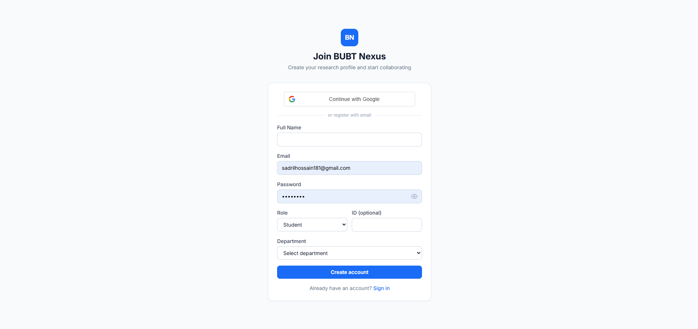
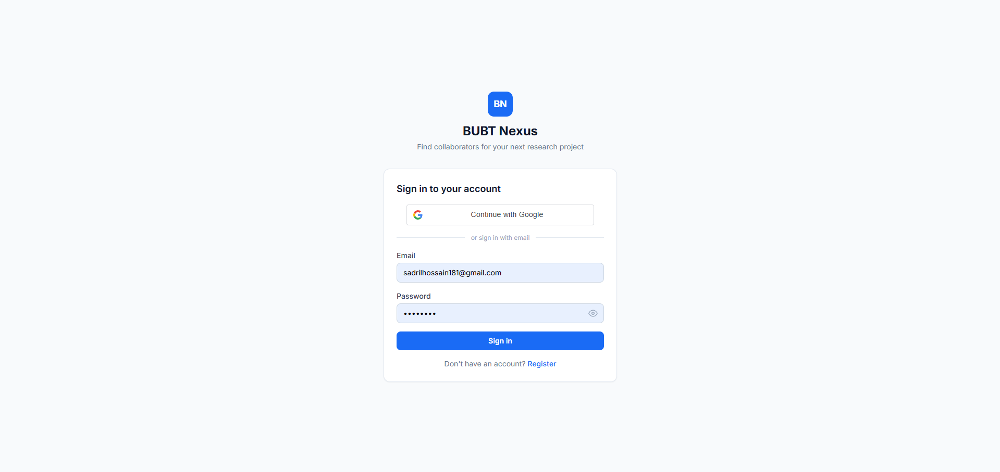
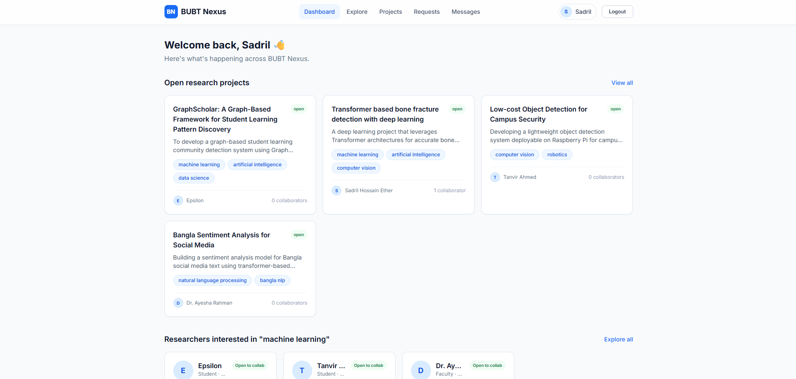
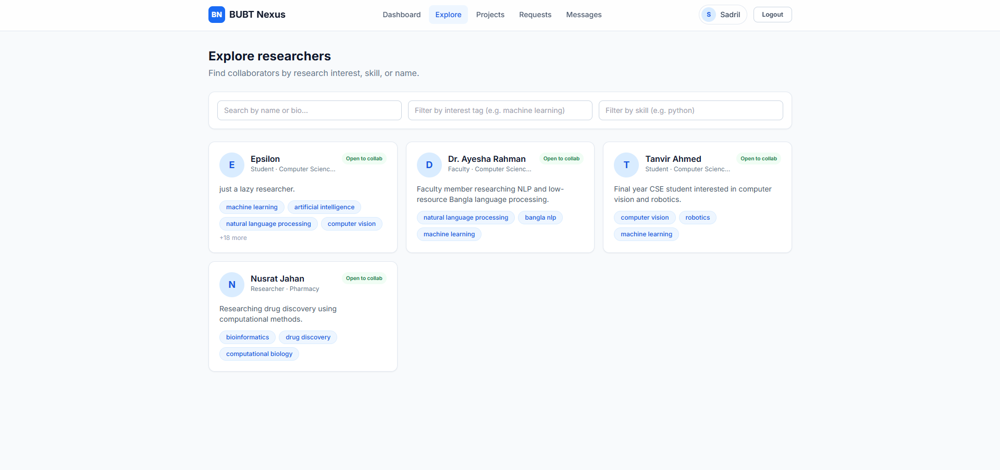
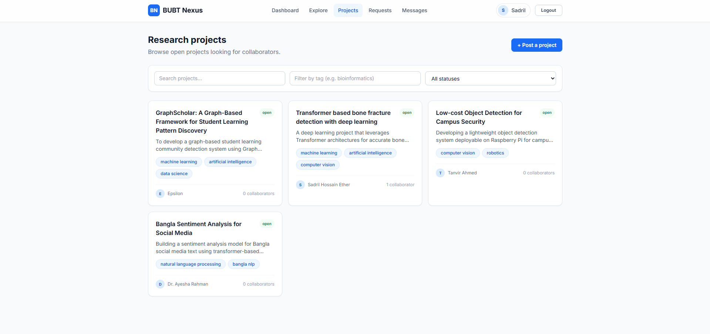
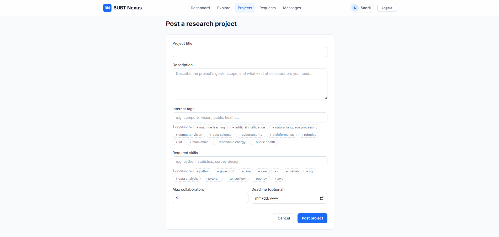
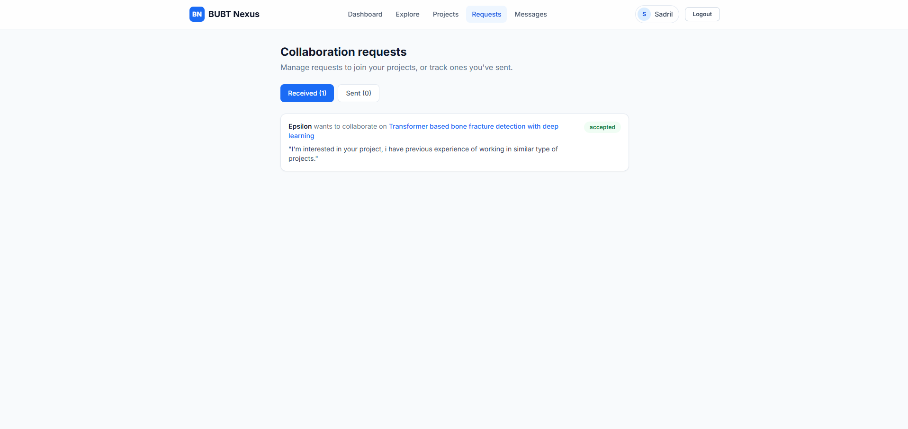
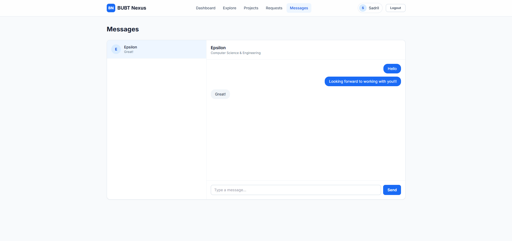
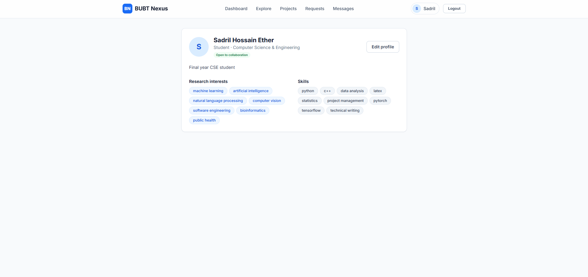
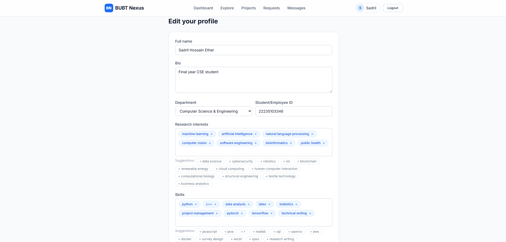

# BUBT Nexus

A MERN-stack platform for students and researchers to find collaborators based on shared research interests and skills.

## Features

- **Email-verified accounts** — registration doesn't log the user in; a verification link is emailed (or logged to console in dev mode) and must be clicked before login is allowed
- **Continue with Google** — sign up or log in with a Google account (ID token verified server-side); Google accounts are auto-verified since Google already confirmed the email
- **Research profiles** — bio, department, role, publications, and external links (Google Scholar, LinkedIn, website)
- **Interest tags & skills** — searchable/filterable tags on both profiles and projects
- **Project posting** — post open research projects with required skills, tags, and collaborator limits
- **Collaboration requests** — send, receive, accept, or decline requests to join a project
- **Messaging** — real-time 1:1 chat (Socket.io) between connected collaborators
- **Admin panel with project approval** — every newly posted project is hidden from everyone but its owner until an admin approves it via a separate `/admin` panel (its own login, separate from regular users). Admins can approve, reject (with a reason shown to the poster), delete any project, and suspend/reactivate user accounts. Editing an approved project's content automatically sends it back into the review queue.
- **Public browsing** — a marketing landing page (`/`) greets logged-out visitors; the dashboard, explore, projects, project detail, and profile pages are all viewable without an account. Posting a project, sending a collaboration request, and messaging still require signing in.
- **Project attachments** — up to 3 files (images, PDF, Word, or plain text; 5MB each) can be attached when posting a project, stored on the server and shown on the project detail page (images as thumbnails, other files as download links).

## Tech Stack

- **MongoDB** — Mongoose ODM, text/tag indexes for search
- **Express** — REST API, JWT auth, centralized error handling
- **React** — Vite, React Router, Context API, Tailwind CSS
- **Node.js** — Socket.io for real-time messaging, Multer for file uploads

## Project Structure

```
bubt-nexus/
├── server/                 # Express + MongoDB API
│   ├── config/db.js        # MongoDB connection
│   ├── models/              # User, Project, CollabRequest, Conversation, Message
│   ├── controllers/         # Business logic per resource
│   ├── routes/               # Express routers
│   ├── middleware/          # JWT auth guard (+ optionalAuth), admin guard, upload (multer), error handler
│   ├── utils/                # Token generation, email service, DB seed & create-admin scripts
│   ├── uploads/               # Uploaded project attachments (gitignored, created at runtime)
│   └── server.js             # App entry point + Socket.io setup
│
└── client/                 # React (Vite) frontend
    └── src/
        ├── pages/            # Route-level views
        ├── components/       # Navbar, cards, tag input, route guard
        ├── context/          # AuthContext (global user state)
        ├── services/         # Axios API wrappers per resource
        └── App.jsx           # Routing
```

## Getting Started

### Prerequisites
- Node.js 18+
- MongoDB running locally or a MongoDB Atlas connection string

### 1. Backend setup

```bash
cd server
cp .env.example .env      # then fill in MONGO_URI and JWT_SECRET
npm install
npm run seed               # optional: populate demo users/projects
npm run dev                 # starts on http://localhost:5000
```

Demo accounts created by `npm run seed` (password for all: `password123`, pre-verified so you can log in immediately):
- ayesha.rahman@bubt.edu.bd (faculty)
- tanvir.ahmed@bubt.edu.bd (student)
- nusrat.jahan@bubt.edu.bd (researcher)

**About email verification:** new accounts created through the Register form are *not* logged in immediately — a verification link is sent to their email and must be clicked before `/api/auth/login` will succeed. If you leave `EMAIL_HOST`/`EMAIL_USER`/`EMAIL_PASS` blank in `server/.env`, the server just prints the verification link to the backend console instead of sending real mail, so you can test the flow without setting up SMTP. To send real emails, fill in those vars with SMTP credentials (Gmail app password, Mailtrap, SendGrid SMTP, etc.).

**About "Continue with Google":** to enable it, create an OAuth 2.0 Client ID (Web application) at [Google Cloud Console → Credentials](https://console.cloud.google.com/apis/credentials), add `http://localhost:5173` under Authorized JavaScript origins, then set the same client ID in **both**:
- `server/.env` → `GOOGLE_CLIENT_ID` (used to verify tokens)
- `client/.env` → `VITE_GOOGLE_CLIENT_ID` (used to render the button)

If `VITE_GOOGLE_CLIENT_ID` is left blank, the Google button simply doesn't render — everything else still works with email/password.

**Creating your first admin account:** the public registration endpoint can never create an admin account (this is enforced server-side, not just hidden in the UI). Instead, set `ADMIN_NAME`, `ADMIN_EMAIL`, and `ADMIN_PASSWORD` in `server/.env`, then run:
```bash
npm run create-admin
```
This creates a new admin account (or promotes an existing user with that email to admin) and marks it verified/active. Log into the admin panel at `http://localhost:5173/admin/login` with those credentials — it's a completely separate login page from the regular user login.

### 2. Frontend setup

```bash
cd client
cp .env.example .env
npm install
npm run dev                 # starts on http://localhost:5173
```

The Vite dev server proxies `/api` requests to `http://localhost:5000`.

### 3. Open the app
Visit `http://localhost:5173`, register an account (or use a seeded demo account), fill out your research profile, and start exploring projects and collaborators.

## API Overview

| Method | Endpoint | Description |
|---|---|---|
| POST | `/api/auth/register` | Create account (unverified, sends verification email) |
| GET | `/api/auth/verify-email/:token` | Verify email, returns JWT |
| POST | `/api/auth/resend-verification` | Resend verification link |
| POST | `/api/auth/login` | Login, returns JWT (blocked until verified) |
| POST | `/api/auth/google` | Sign in/up with a Google ID token, returns JWT |
| GET | `/api/auth/me` | Current user |
| GET | `/api/users?interest=&skill=&q=` | **Public.** Search/filter researchers (excludes yourself from results if logged in) |
| PUT | `/api/users/profile` | Update own profile |
| GET | `/api/projects?tag=&skill=&q=&status=` | **Public.** List/filter **approved** projects (or your own, any status, via `owner=<your id>` when logged in) |
| POST | `/api/projects` | Create project (multipart/form-data — up to 3 file attachments) — starts `pending`, invisible to others until approved |
| GET | `/api/projects/:id` | **Public.** View a project (non-approved ones only visible to their owner or an admin) |
| PUT/DELETE | `/api/projects/:id` | Update (multipart, can add more attachments) / delete project (editing content re-queues it for review) |
| POST | `/api/collab-requests` | Send collaboration request (only allowed on approved projects) |
| GET | `/api/collab-requests/received` \| `/sent` | List requests |
| PUT | `/api/collab-requests/:id` | Accept/reject request |
| GET/POST | `/api/messages/conversations` | List/start conversations |
| GET/POST | `/api/messages/:conversationId` | Fetch/send messages |
| POST | `/api/admin/login` | Admin-only login (separate from `/api/auth/login`), returns JWT |
| GET | `/api/admin/stats` | Dashboard counts |
| GET | `/api/admin/projects/pending` | Projects awaiting review |
| GET | `/api/admin/projects?approvalStatus=&q=` | All projects, any status |
| PUT | `/api/admin/projects/:id/approve` \| `/reject` | Approve or reject (with reason) a project |
| DELETE | `/api/admin/projects/:id` | Admin can remove any project outright |
| GET | `/api/admin/users?q=` | List all non-admin users |
| PUT | `/api/admin/users/:id/toggle-active` | Suspend or reactivate an account |

All routes are marked **Public** above where guests can access them; everything else requires a `Bearer` JWT in the `Authorization` header (every `/api/admin/*` route besides `/login` additionally requires `role: "admin"`). Uploaded attachments are served statically at `/uploads/<filename>` on the backend origin.

## Notes on extending this further
- Add pagination controls in the UI (API already supports `page`/`limit`)
- Add file upload for avatars (e.g. via multer + S3/Cloudinary)
- Add email notifications for new collaboration requests
- Add a recommendation score that ranks matches by tag overlap


# Screenshots

### Authentication



### Dashboard


### Explore Researchers


### Projects



### Requests


### Messages


### Profile

